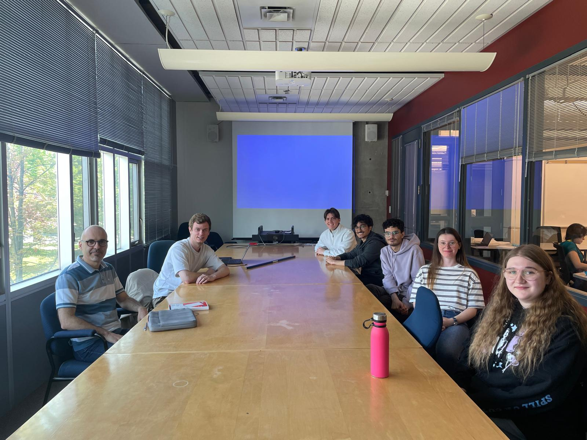

::: {.hero}
::: {.hero-text}
**Associate Professor and University Research Chair**  
**Faculty of Computer Science, Dalhousie University**  
Head of the Systems Research Cluster · IEEE Senior Member

My research focuses on reliable and secure wireless networks, with emphasis on spectrum and energy efficiency, interference mitigation, anomaly detection, and semantic communication for the Internet of Things.

I am also an external research collaborator with the ROCS team at LISN, Université Paris-Saclay, and coordinate the joint doctoral program between Dalhousie University and Université Paris-Saclay.

I hold a PhD in Computer Science from IMT Atlantique, Rennes and a [habilitation](habilitation.qmd) from Université Paris-Saclay in France for my work on radio resource allocation in cellular networks.
:::

::: {.hero-media}

:::
:::

## Spark Lab

::: {.lab-highlight}
::: {.lab-highlight-media}

:::

::: {.lab-highlight-text}
I lead **Spark Lab** at Dalhousie University, where students and collaborators study wireless systems through theory, optimization, measurement, and learning-based methods. Our work connects wireless networking, IoT, security, and intelligent communication systems.

**Current Research Directions**

- Anomaly detection and RF fingerprinting for wireless security
- Low-power wide-area networks for wireless IoT (LoRa, LR-FHSS)
- Wireless coexistence and spectrum monitoring in unlicensed bands
- Semantic and task-oriented communication for IoT
- Wireless digital twins

[Meet the lab](lab.qmd)
:::
:::

## News

::: {.news-list}
::: {.news-item}
**October 2026**  `PhD` `LR-FHSS` `Massive IoT`  
Congratulations to **Juliana El Rayess** on completing her PhD, **Reliability and Energy Efficiency for Channel Access in Massive IoT**, co-supervised between Saint Joseph University of Beirut and Université Paris-Saclay.
:::

::: {.news-item}
**2026**  `Papers` `PIMRC` `MobiWac` `SECON`  
A strong year for the lab: papers at **IEEE PIMRC 2026**, **MobiWac'26**, **IEEE SECON 2026**, **IEEE DySPAN 2026**, **IEEE CCECE 2026**, the **ACM DTwin '26** workshop, and **SECURE-AGRO 2026**, plus a letter accepted in **IEEE Communications Letters**. See [Publications](publications.qmd).
:::

::: {.news-item}
**August 2026**  `Grant` `Defence` `Secure Communications`  
New CDDE pilot project with **TKMS** on a **Trusted and Secure Air-to-Sea Communication System**.
:::

::: {.news-item}
**July 2026**  `Appointment` `Paris-Saclay`  
Appointed **External Research Collaborator** with the ROCS team at LISN, Université Paris-Saclay.
:::

::: {.news-item}
**June 2026**  `Tutorial` `EuCNC` `Semantic Communication`  
Delivered the tutorial **Semantic Communication for the Internet of Things: Frameworks, Optimization, and Open Challenges** at **EuCNC & 6G Summit 2026** in Spain, following **IEEE CCECE 2026**.
:::

::: {.news-item}
**May 2026**  `Dataset` `RFFI` `Wi-Fi`  
New datasets released on the [Resources](resources/index.qmd) page: Wi-Fi RFFI Signal-Level Synthetic Traces and Protocol-Level Emulated Traces, supporting impersonation detection research.
:::

::: {.news-item}
**May 2026**  `Tutorial` `IEEE CCECE` `Semantic Communication`  
Delivered the tutorial **Semantic Communication for the Internet of Things: Frameworks, Optimization, and Open Challenges** at **IEEE CCECE 2026**. [More details](https://ccece2026.ieee.ca/program/tutorials/)
:::

::: {.news-item}
**January 2026**  `Grant` `Mobility` `Security`  
Awarded a DND IDEaS contract for **TOPSSIM: Trustworthy Operator Platform for Seamless and Secure Inter-PLMN Mobility**.
:::

::: {.news-item}
**November 2025**  `Grant` `IoT Security` `AI`  
Received NCC Cyber Security Innovation Network grant for **AI-Driven IoT Threat Intelligence: Securing Smart Environments Across Zigbee, Z-Wave, Bluetooth, and Wi-Fi Networks**.
:::

::: {.news-item}
**2025-2026**  `Student Paper` `Conference` `LR-FHSS`  
Student work by **Juliana El Rayess** was presented at **WPMC 2025** and accepted at **CCNC 2026** on energy efficiency and reliability in LR-FHSS networks.
:::
:::
